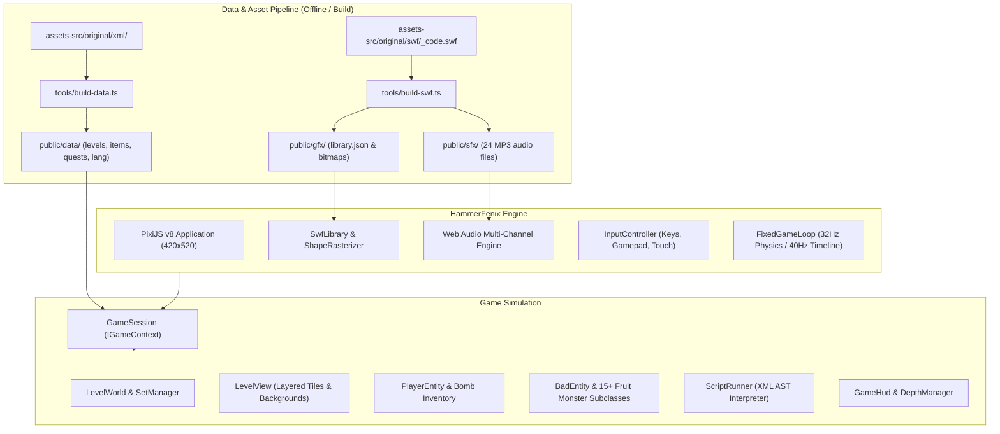

# HammerFenix 🔨❄️

> A faithful, high-performance web recreation of Motion Twin's classic 2D platformer **Hammerfest** (2006), built with TypeScript, PixiJS v8, Vite, and Web Audio.

[](https://github.com/Greaple/HammerFenix/actions/workflows/ci.yml)
[](https://creativecommons.org/licenses/by-nc-sa/4.0/)

---

## 🌟 Overview

**HammerFenix** revives the iconic Flash game **Hammerfest**, originally developed by the legendary French studio [Motion Twin](https://motion-twin.com/) in 2006.

When Flash was deprecated, Motion Twin graciously open-sourced the original codebase and asset archives under the **CC BY-NC-SA 4.0** license. HammerFenix reconstructs the entire game engine from the ground up for modern browsers with:

- **100% Faithful Physics & Simulation**: Subpixel movement, one-way platforms, bomb kicking, bouncing, fruit monster AI, Tubby hurry-up mechanics, and 32 Hz fixed-timestep physics.
- **782 Levels across 17 Level Sets**: Adventure, Basic Adventure, Deepnight, Ayame, Bumdum, Time Attack, Tutorial, Soccer, and more.
- **Dynamic Scripting Engine**: Complete AST interpreter supporting all 13 script triggers, 24 event types, boss battles, dynamic variable interpolation, and secret portals.
- **Vector Flash SWF Pipeline**: Native SWF asset decompiler generating HiDPI vector textures, sprite sheets, and nested movieclip timelines rendered with PixiJS v8.
- **Multi-channel Web Audio Engine**: All 21 original sound effects and 3 music tracks faithfully mixed with channel priorities and user gesture unlocking.
- **Interactive SWF Symbol Browser**: Built-in inspector dialog to browse, filter, play, and scrub through all 277 extracted Flash linkage symbols.
- **Multilingual Support**: French, English, and Spanish localizations included for all quests, items, and interface text.
- **Responsive & Touch Friendly**: Seamless play on desktop keyboards, gamepads, or mobile touchscreens with virtual D-pad and action buttons.

---

## 📜 Credits & License

- **Original Game & Concepts**: © 2006 **Motion Twin**.
- **Original Source & Assets**: [motion-twin/hammerfest](https://github.com/motion-twin/hammerfest).
- **License**: Creative Commons Attribution-NonCommercial-ShareAlike 4.0 International ([CC BY-NC-SA 4.0](https://creativecommons.org/licenses/by-nc-sa/4.0/)).
- **Legal Notice**: This project is created strictly for non-commercial educational, preservation, and research purposes. All trademarks, characters, artwork, and audio remain the property of Motion Twin.

---

## 🎮 Controls

| Action                   | Keyboard                              | Touch / Gamepad                  |
| :----------------------- | :------------------------------------ | :------------------------------- |
| **Walk Left / Right**    | `◀` `▶` or `A` `D` (or `Q` on AZERTY) | D-Pad Left / Right, Left Stick   |
| **Jump**                 | `▲` or `W` (or `Z` on AZERTY)         | D-Pad Up / Jump Button, A Button |
| **Drop Down**            | `▼` or `S`                            | D-Pad Down, Down                 |
| **Drop / Detonate Bomb** | `Space` / `Ctrl` / `X`                | Bomb Button, B / X Button        |
| **Pause / Resume**       | `P` / `Escape`                        | Pause Button, Start Button       |
| **Restart Level**        | `R`                                   | Toolbar Restart Button           |
| **Mute / Unmute**        | `M`                                   | Toolbar Audio Button             |

---

## 🏗️ Architecture & Technology



---

## 🚀 Getting Started

### Prerequisites

- [Node.js](https://nodejs.org/) `>= 20.0.0`
- `npm`

### Installation

```bash
# Clone the repository
git clone https://github.com/Greaple/HammerFenix.git
cd HammerFenix

# Install dependencies (use legacy-peer-deps for npm)
npm install --legacy-peer-deps
```

### Running Locally

```bash
# Start Vite development server
npm run dev
```

Open [http://localhost:5173](http://localhost:5173) in your browser.

### Running Tests & Verification

```bash
# Run unit tests (Vitest)
npm test

# Typecheck TypeScript codebase
npm run typecheck

# Check code formatting (Prettier)
npm run format:check

# Build production bundle
npm run build
```

---

## 🛠️ Built-in SWF Symbol Browser

To view and interact with all 277 extracted Flash vectors, click the **Assets** button in the header toolbar or use the native `<dialog>` browser. You can filter by category or linkage name, scrub frame-by-frame, and view character metadata in real-time.
